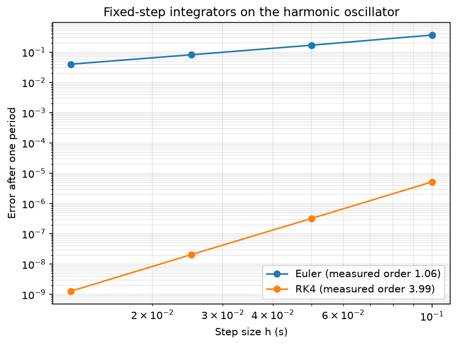
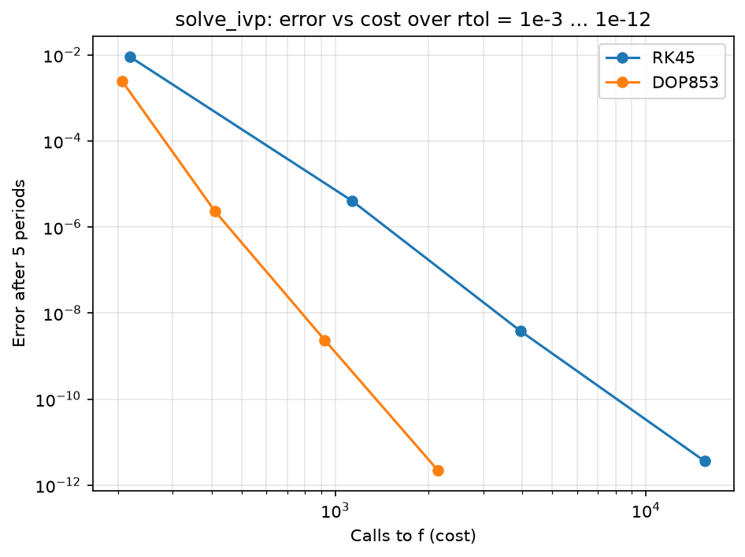

# numerical-orbit-propagator

Numerical orbit propagator in Python: two-body equations of motion,
integration with SciPy `solve_ivp`, validation against Kepler, and
perturbations (starting with J2) as plug-in forces.

## Roadmap

- [x] Two-body equations of motion as a first-order state derivative, with tests
- [x] Integrator comparison: Euler, RK4 and SciPy `solve_ivp` on a test problem
- [ ] Orbit propagation from initial orbital elements, with 2-D/3-D plots
- [ ] Validation: energy and angular-momentum drift, comparison with Kepler, tolerance study
- [ ] J2 perturbation as a plug-in force; RAAN drift checked against the analytic rate
- [ ] Continuous integration (GitHub Actions running pytest)

## Equations of motion

Two-body relative motion with the satellite's mass neglected (μ = GM):

    r̈ = −μ r / r³

Rewritten as six first-order equations for the integrator, with state
y = [x, y, z, vx, vy, vz] (km, km/s, ECI):

    ẏ = [ v ,  −μ r / r³ ]

`two_body_acceleration(r)` holds the physics; `two_body_derivative(t, y)`
slices the state, calls the acceleration and stacks [v, a]. Keeping them
separate lets further forces (J2, drag) be added as extra acceleration
functions.

Hand check: |a| = μ/r² = 8.676 m/s² at 400 km altitude (88% of g₀).

## Integrator benchmark

Before propagating orbits, each integrator was tested on the harmonic
oscillator (x'' = -x), whose exact solution is known
(`python -m benchmarks.oscillator_benchmark`).

| Finding | Result |
|---|---|
| Measured order (log-log slope) | Euler 1.06, RK4 3.99 (theory 1 and 4) |
| Energy after 5 periods, h = 0.1 (exact 0.5) | Euler 11.4 (grows by 1 + h² every step), RK4 0.499998 |
| solve_ivp defaults (RK45, rtol = 1e-3) | error 9.2e-3 after 5 periods: not usable for orbits |
| Cost to reach error ~1e-12 | RK45: 15,446 calls to f; DOP853: 2,138 (7x fewer) |

**Choice for orbit propagation:** `solve_ivp` with `DOP853` and tight
tolerances (rtol ~ 1e-10 or below), validated further against Kepler in the
next stage.

## Structure

    propagator/
        constants.py            μ, Earth radius, paths (units in the names)
        dynamics.py             accelerations and the state derivative
        integrators.py          fixed-step Euler and RK4
        reference_problems.py   test problems with exact solutions
    benchmarks/
        oscillator_benchmark.py integrator accuracy and cost study
    tests/
        test_dynamics.py
        test_integrators.py
    figures/, output/           benchmark results

## Run

    python -m propagator.dynamics             # hand check
    python -m benchmarks.oscillator_benchmark # integrator study
    python -m pytest -v                       # 27 tests

## Assumptions

Point-mass Earth, no drag, no Sun/Moon, no solar radiation pressure,
no thrust. Each is added later as a separate force.